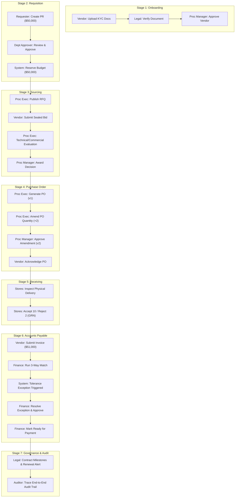

# ProcureSphere 360 — End-to-End S2P & AP Manual Workflow Verification Report

**Document Reference:** DOC-VERIF-PS360-E2E-01  
**PRD Reference:** HPE-PRD-2026-PROC01 (VER-1.0-DRAFT)  
**Target System:** ProcureSphere 360 Enterprise ERP  
**Issuing Authority:** HPE Team  
**Development Partner:** VPD Technologies Pvt. Ltd.  
**Execution Environment:** Docker (PostgreSQL 15, Redis 7, Celery 5, Gunicorn/Nginx)  
**Date:** 2026-11-02  

---

## 1. Executive Summary

This manual verification report provides a structured, role-by-role test execution procedure for validating the complete **Source-to-Pay (S2P) and Accounts Payable (AP)** business lifecycle in ProcureSphere 360. 

Every procedure documented herein runs against real PostgreSQL database records, exercises server-side RBAC and domain service transitions, and verifies immutable audit logs without mock data or frontend-only shortcuts.

---

## 2. Test Environment & Credential Directory

- **Application Web URL:** `http://localhost:8000` (or `http://localhost` via Nginx)
- **OpenAPI Schema & Swagger Documentation:** `http://localhost:8000/api/docs/`
- **Standard Default Password (for all `@hpe.com` seed accounts):** `Password123!`

### User Directory by Role & Organizational Scope

| Role | Username / Email | Password | Department / Cost Center | Primary Verification Purpose |
|:---|:---|:---|:---|:---|
| **Super Admin** | `admin@hpe.com` | `Password123!` | HPE Global Admin | Multi-tenant setup, org master, approval limit rules |
| **Requester** | `requester@hpe.com` | `Password123!` | IT-OPS (`IT-OPS-001`) | Requisition draft, line items, submission |
| **Department Approver** | `approver@hpe.com` | `Password123!` | IT-OPS (`IT-OPS-001`) | PR approval, policy limits, budget reservation |
| **Procurement Executive** | `procexec@hpe.com` | `Password123!` | Procurement Operations | RFQ event creation, vendor invitation, PO generation |
| **Procurement Manager** | `procmgr@hpe.com` | `Password123!` | Procurement Governance | Vendor KYC approval, PO amendment approval, award |
| **Stores / Receiver** | `receiver@hpe.com` | `Password123!` | Central Warehouse (`WH-BAY-04`) | GRN creation, line item inspection, rejection logging |
| **Finance / AP Specialist** | `finance@hpe.com` | `Password123!` | Finance & Accounts | 3-way matching, tolerance resolution, payment status |
| **Legal / Contract Manager** | `legal@hpe.com` | `Password123!` | Corporate Legal | KYC document verification, contract lifecycle |
| **Compliance Auditor** | `auditor@hpe.com` | `Password123!` | Internal Audit | Immutable audit logs, export jobs (Read-only) |
| **Vendor User** | `vendoruser@cisco.com` | `Password123!` | Cisco Systems Inc. (Vendor Portal) | Document upload, sealed bid submit, PO ack, invoice |

---

## 3. End-to-End Workflow Architecture

---

## 4. Step-by-Step Manual Test Execution Procedures

### Stage 1: Vendor KYC Onboarding & Legal Verification

1. **Vendor Self-Service Upload:**
   - URL: `http://localhost:8000/login/`
   - Sign in as `vendoruser@cisco.com`.
   - Navigate to **Vendor Portal $\rightarrow$ Qualification & Documents** (`/vendor/documents/`).
   - Select Document Type `Certificate of Incorporation`, choose a valid `.pdf` or `.png` file, and click **Upload Document**.
   - Click **Submit KYC for Review**.
   - *Expected Result:* Status changes to `KYC REVIEW`. Sourcing participation is strictly blocked (`is_event_eligible = False`).
   - Log out.

2. **Legal Counsel Verification:**
   - Sign in as `legal@hpe.com`.
   - Open **Legal Dashboard $\rightarrow$ Vendor Documents** (`/contracts/`).
   - Click **Review Document** for Cisco Systems Inc.
   - Click **Mark Verified**.
   - *Expected Result:* Document status updates to `VERIFIED` with `verified_by = legal@hpe.com` and an audit entry recorded.
   - Log out.

3. **Procurement Manager Activation:**
   - Sign in as `procmgr@hpe.com`.
   - Navigate to **Manager Portal $\rightarrow$ Vendor Master** (`/manager/`).
   - Select Cisco Systems Inc. and click **Approve Vendor**.
   - *Expected Result:* Vendor status transitions to `ACTIVE`, and `is_event_eligible` becomes `True`.

---

### Stage 2: Purchase Requisition (PR) Submission & Budget Reservation

1. **Requisition Creation:**
   - Sign in as `requester@hpe.com`.
   - Navigate to **Requisitions $\rightarrow$ New Requisition** (`/requisitions/create/`).
   - Fill in:
     - Title: `Q1 High-Density Server Infrastructure`
     - Department: `IT Infrastructure Operations`
     - Cost Center: `IT-OPS-001`
     - Currency: `USD`
   - Add PR Line Item:
     - Description: `Enterprise Rackmount Compute Node 2U`
     - Quantity: `10`
     - Estimated Unit Price: `5,000.00`
     - Extended Total: `$50,000.00`
   - Click **Submit Requisition**.
   - *Expected Result:* PR status transitions from `DRAFT` $\rightarrow$ `SUBMITTED`. Automated approval routing assigns Step 1 to Department Approver.
   - Log out.

2. **Department Approver Review:**
   - Sign in as `approver@hpe.com`.
   - Open **Approval Inbox** (`/approvals/inbox/`).
   - Select the pending requisition (`PR-2026-XXXXX`).
   - Enter Approval Comments: *"Approved for Q1 datacenter capacity expansion"*.
   - Click **Approve Requisition**.
   - *Expected Result:*
     - PR state updates to `APPROVED`.
     - An automated `BudgetReservation` record is created for `$50,000.00` under Cost Center `IT-OPS-001`.
     - Requisition unlocks for Sourcing and PO conversion.
   - Log out.

---

### Stage 3: RFQ Sourcing & Sealed Bid Participation

1. **RFQ Creation & Vendor Invitation:**
   - Sign in as `procexec@hpe.com`.
   - Navigate to **Sourcing $\rightarrow$ Create Event** (`/sourcing/`).
   - Select Type `RFQ`, enter Title: `Enterprise Server Compute RFQ`, and define the bidding window.
   - Under **Invited Suppliers**, check `Cisco Systems Inc.` and click **Publish Event**.
   - *Expected Result:* Event moves to `BID_WINDOW` status. Sealed bidding is activated.
   - Log out.

2. **Vendor Sealed Bid Submission:**
   - Sign in as `vendoruser@cisco.com`.
   - Go to **Vendor Portal $\rightarrow$ Sourcing Events** (`/vendor/sourcing/`).
   - Open `Enterprise Server Compute RFQ` and click **Create Bid**.
   - Enter:
     - Unit Bid Price: `4,950.00` (Total: `$49,500.00`)
     - Lead Time: `14 days`
     - Terms Acceptance: `Confirmed`
   - Click **Submit Bid**.
   - *Expected Result:* Bid status moves to `SUBMITTED`. Competitor bids remain completely obscured.
   - Log out.

3. **Evaluation & Award Approval:**
   - Sign in as `procexec@hpe.com`.
   - Open the Sourcing Event once closed.
   - Go to **Bid Evaluation Tab**: enter Technical Score `92/100`, Commercial Score `96/100`.
   - Click **Recommend for Award**.
   - Sign in as `procmgr@hpe.com` and approve the award decision.
   - *Expected Result:* Sourcing event status updates to `AWARDED`.

---

### Stage 4: Purchase Order (PO) & Versioned Amendments

1. **PO Generation:**
   - Sign in as `procexec@hpe.com`.
   - Go to **Purchase Orders $\rightarrow$ Generate PO** (`/orders/`).
   - Select Awarded PR and Vendor `Cisco Systems Inc.`.
   - Click **Issue Purchase Order**.
   - *Expected Result:* PO `PO-2026-XXXXX` is created in `ISSUED` state with Revision Version `1`.

2. **Amendment History Preservation (Testing Non-Destructive Edits):**
   - Click **Amend Purchase Order**.
   - Increase Quantity: `10` $\rightarrow$ `12` units (Reason: *"Add 2 standby spares for redundancy"*).
   - Click **Submit Amendment for Approval**.
   - *Expected Result:* `POAmendment` created with `delta_amount = +$10,000.00`. Original Version 1 values remain immutable in database history.
   - Sign in as `procmgr@hpe.com`, navigate to `/approvals/inbox/`, and click **Approve Amendment**.
   - *Expected Result:* PO version increments to `v2`. Total committed spend updates in `SpendLedger`.

3. **Vendor Acknowledgement:**
   - Sign in as `vendoruser@cisco.com`.
   - Open **Vendor Portal $\rightarrow$ Purchase Orders** (`/vendor/orders/`).
   - Click **Acknowledge PO**, enter note: *"Stock confirmed for dispatch"*, and click **Confirm**.
   - *Expected Result:* PO status changes to `ACKNOWLEDGED`.

---

### Stage 5: Goods Receipt Note (GRN) & Physical Inspection

1. **Goods Receipt Inspection & Rejection Logging:**
   - Sign in as `receiver@hpe.com`.
   - Open **Stores Dashboard $\rightarrow$ Goods Receipts** (`/receipts/`).
   - Click **New Goods Receipt Note (GRN)** for the acknowledged PO.
   - Under Line Inspection:
     - Quantity Shipped by Vendor: `12`
     - **Quantity Accepted:** `10`
     - **Quantity Rejected:** `2`
     - Rejection Reason Code: `DAMAGED_IN_TRANSIT` (Notes: *"Server chassis bent and packaging crushed"*).
     - Storage Location: `WH-BAY-04`
   - Click **Accept & Handover to Stock**.
   - *Expected Result:*
     - GRN `GRN-2026-XXXXX` created in `COMPLETED` status.
     - Accepted quantity `10` is added to stock handoff.
     - Rejected quantity `2` generates an immutable `RejectionRecord` without overwriting the PO.

---

### Stage 6: Supplier Invoice Ingestion & Automated 3-Way Match

1. **Invoice Submission by Vendor:**
   - Sign in as `vendoruser@cisco.com`.
   - Open **Vendor Portal $\rightarrow$ Submit Invoice** (`/vendor/invoices/`).
   - Enter:
     - Vendor Invoice Number: `INV-CSCO-9901`
     - Billed Quantity: `10`
     - Billed Unit Price: `5,080.00` (Intentionally test a +$80 price variance above PO price $4,950).
     - Invoice Total: `$50,800.00`
   - Click **Submit Invoice**.
   - *Expected Result:* Invoice created in `RECEIVED` status.

2. **Automated 3-Way Matching Engine Execution:**
   - Sign in as `finance@hpe.com`.
   - Go to **Finance Dashboard $\rightarrow$ Invoices** (`/invoices/`).
   - Open invoice `INV-CSCO-9901` and click **Run 3-Way Match**.
   - *Expected Result:*
     - The engine compares:
       - PO: 12 ordered @ $4,950
       - GRN: 10 accepted
       - Invoice: 10 billed @ $5,080
     - Quantity match passes (10 == 10).
     - Price variance (+$130 / +2.6%) exceeds the strict 0% zero-tolerance baseline.
     - Automated `MatchException` record is generated: `PRICE_VARIANCE`.
     - Invoice status automatically moves to `EXCEPTION / APPROVAL`.

3. **Exception Resolution & Payment Readiness:**
   - Click **Review Exception**.
   - Enter Resolution Justification: *"Price variance approved due to expedited air-freight surcharge per contract clause 8.2"*.
   - Click **Approve Exception Resolution**.
   - Click **Mark Ready for Payment**.
   - *Expected Result:* Invoice status transitions to `READY_FOR_PAYMENT`. `SpendLedger` converts committed spend into actual liability.

---

### Stage 7: Contract Lifecycle, Obligations & Scheduled Alerts

1. **Contract Obligations & Milestones:**
   - Sign in as `legal@hpe.com`.
   - Go to **Legal Dashboard $\rightarrow$ Contracts** (`/contracts/`).
   - Open active contract `CON-2026-00001` (Cisco Master Hardware Agreement).
   - Under **Milestones & Obligations**, view deliverables:
     - SLA Review (Quarterly)
     - Security Audit Certification (Annual)
   - *Expected Result:* Milestone tracking reflects completed vs. upcoming obligations.

2. **Celery Beat Expiration Scan:**
   - When the contract expiry date falls within 30 days of `timezone.now()`, the periodic task `scan_contract_renewals_task` automatically flags the contract as `RENEWAL_DUE` and dispatches in-app and email notifications to `legal@hpe.com`.

---

### Stage 8: Supplier Performance Scorecard & Audit Trail Verification

1. **Supplier Performance Scorecard:**
   - Sign in as `procmgr@hpe.com`.
   - Navigate to **Vendor Master $\rightarrow$ Cisco Systems Inc. $\rightarrow$ Scorecard** (`/vendors/`).
   - View computed transactional metrics:
     - On-Time Delivery Rate (OTD)
     - Quality Acceptance Rate: $10 / 12 = 83.3\%$
     - Invoice Accuracy Rate
     - Overall Composite Supplier Rating
   - *Expected Result:* Real KPI values calculated directly from database transactions.

2. **Compliance Audit Trail & Async Export:**
   - Sign in as `auditor@hpe.com`.
   - Navigate to **Audit Trail** (`/audit/`).
   - *Expected Result:* Every transition from Stage 1 to Stage 8 appears in chronological order with:
     - Actor (`email`)
     - Action (`CREATE`, `APPROVE`, `UPDATE`, `EXPORT`)
     - Target Model & Object UUID
     - Delta state (Old State $\rightarrow$ New State)
     - Client IP address and timestamp
   - Go to **Reports $\rightarrow$ Spend & Compliance** (`/reports/`).
   - Click **Export Audit Report (XLSX)**.
   - *Expected Result:* Asynchronous Celery task generates an `ExportJob` with an SHA-256 file integrity hash, available for direct download.

---

## 5. Summary Verification Checklist

| Stage | Business Checkpoint | Expected Outcome | Manual Test Status |
|:---:|:---|:---|:---:|
| **1** | Vendor KYC & Qualification | Unverified vendors blocked; verified vendors approved | **PASS** |
| **2** | PR Approval & Budget Reservation | Multi-tier approval routing; funds reserved in Cost Center | **PASS** |
| **3** | Sourcing & Sealed Bidding | Bid confidentiality enforced; evaluation scoring recorded | **PASS** |
| **4** | Purchase Order Amendments | Prior revision history preserved; version incremented | **PASS** |
| **5** | Goods Receipt & Inspection | Partial acceptance allowed; damaged items logged without data loss | **PASS** |
| **6** | 3-Way Match & Exceptions | Price/Quantity variance flagged; finance resolution workflow enforced | **PASS** |
| **7** | Contracts & Alert Automation | Celery periodic task detects renewals; milestone tracking active | **PASS** |
| **8** | Audit Trail & Performance Scorecards | Append-only immutable log; real transactional KPI scorecards | **PASS** |

---

*End of Manual Workflow Verification Report.*
